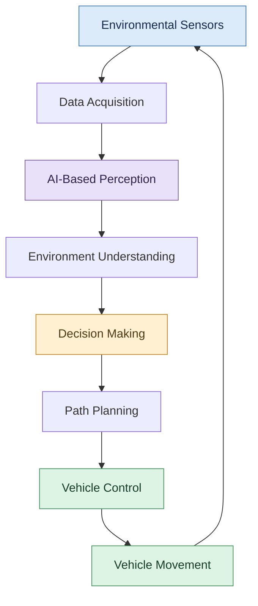

# Exploration-of-AI-Use-Case-Case-study-on-self-driving-cars

## AIM

To study the application of Artificial Intelligence in self-driving cars and analyze how AI technologies enable environmental perception, obstacle detection, decision-making, and autonomous navigation.

## THEORY

Self-driving cars are intelligent vehicles that use Artificial Intelligence (AI), sensors, and computational algorithms to interpret their surroundings and perform driving tasks with varying levels of automation.

AI integrates information from cameras, radar, and other sensors to identify road users, recognize traffic signs, estimate vehicle movement, and support safe navigation.

The major technologies involved are:

- **Computer Vision:** Processes camera images to identify vehicles, pedestrians, traffic signs, and road markings.
- **Machine Learning:** Enables systems to identify patterns and classify objects using trained models.
- **Sensor Fusion:** Combines information from multiple sensors to improve environmental awareness.
- **Path Planning:** Determines a suitable trajectory based on the vehicle's surroundings and destination.
- **Decision-Making Algorithms:** Select appropriate driving actions based on detected objects and road conditions.
- **Vehicle Control Systems:** Translate planned actions into steering, braking, and acceleration commands.

### Real-World Case Studies

**1. Waymo:** Applies autonomous driving technology to support driverless ride services in designated operating areas.

**2. Tesla:** Uses camera-based perception and neural networks in its driver-assistance systems. The level of automation and driver supervision requirements depend on the specific system.

**3. Autonomous Research Vehicles:** Universities and research organizations use AI-driven platforms to investigate perception, navigation, obstacle avoidance, and vehicle control.

## WORKING PRINCIPLE

The working principle of an AI-powered self-driving car involves continuous environmental sensing, perception, planning, and vehicle control.

### System Workflow

1. **Data Acquisition:** Cameras and other sensors collect information about the surrounding environment.
2. **Perception:** AI algorithms detect vehicles, pedestrians, road boundaries, and traffic signals.
3. **Environment Understanding:** The system estimates the positions and movements of relevant road users.
4. **Decision Making:** The system evaluates the driving situation and selects an appropriate action.
5. **Path Planning:** A safe and feasible trajectory is calculated.
6. **Vehicle Control:** Steering, braking, and acceleration commands are generated.
7. **Continuous Feedback:** New sensor measurements are used to update the vehicle's decisions.

### Processing Flowchart

### Illustrative Scenario: Pedestrian Detection

When a pedestrian enters the vehicle's projected path, the perception system detects the person using sensor data. The system estimates the potential collision risk, evaluates the surrounding traffic, and determines whether braking or another safe response is necessary. The vehicle control system then executes the selected action and continues monitoring the environment.

### Applications

- Autonomous passenger transportation
- Driver-assistance and collision-avoidance systems
- Automated parking
- Intelligent logistics and goods transportation
- Road-scene understanding and traffic analysis
- Mobility assistance through appropriately designed vehicle systems

## RESULT

The study demonstrates how Artificial Intelligence integrates perception, sensor fusion, decision-making, path planning, and vehicle control in self-driving cars. These technologies enable vehicles to interpret road conditions and respond to dynamic environments. Their safe deployment depends on system capability, validation, operating conditions, and compliance with applicable safety requirements.
